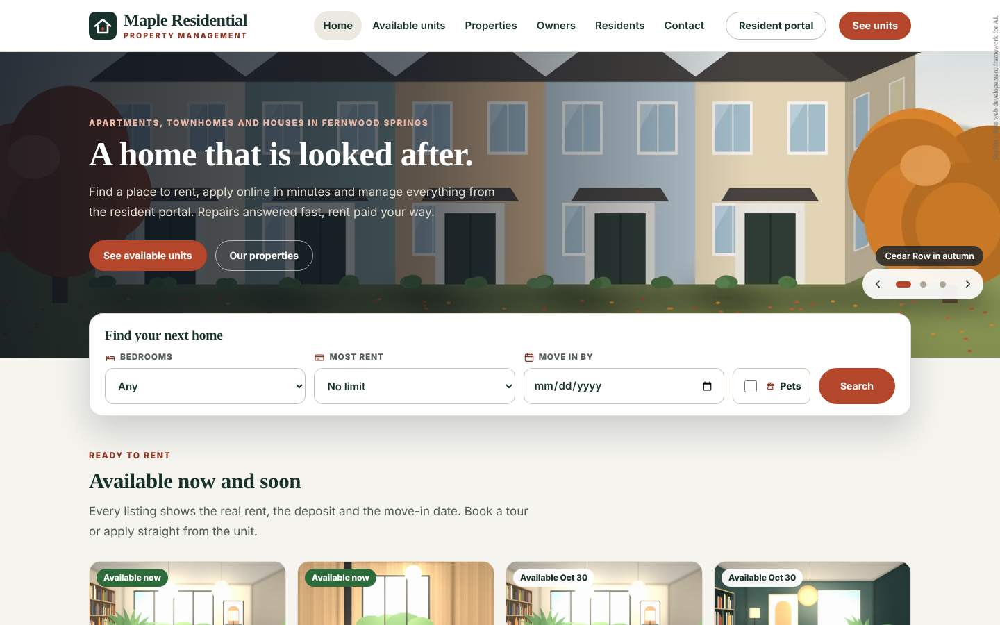
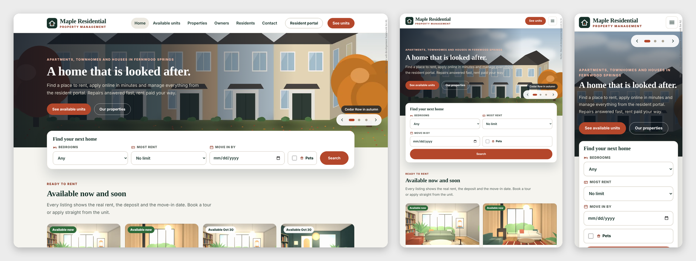

# Maple Residential — SkyNet Property Management Template

A rental property website with a resident portal, online rent payment and a full leasing, maintenance and accounting back office for **ASP.NET Core (.NET 10)**, built on the **SkyNet Framework**.

> **Sample content.** Maple Residential, its town (Fernwood Springs), properties, units, residents, staff and phone numbers are invented placeholders; replace them in the staff area. Every form already saves for real: tour requests, applications, owner inquiries, messages, leases, payments, expenses and resident details are written to the JSON files in `data/`, and emails are sent once you fill in the `app.mail.*` settings.

## Features

- **37 pages:** 11 public (Home, Properties, Property, Available units, Unit, Apply, Owners, Residents, Resident portal, Contact, Policies) and 26 staff (sign-in, Dashboard, Properties, Units, Showings, Applications, Leases, Residents, Work orders, Make-ready, Inspections, Vendors, Rent and payments, Expenses, Reports, Owners, Ownership, Payouts, Pages, Media library, Messages, Notices, Staff, Settings, Activity log, My account)
- **Unit search:** filter by property, bedrooms, highest rent, move-in date and pets. Each listing shows the real rent, the deposit and the move-in date, with a photo and video gallery, a full-screen slide show, features and a floor plan that opens larger
- **Tours:** visitors pick a day and a time slot (Monday to Saturday); a slot already booked for that home cannot be taken twice. Staff confirm, mark done or no-show, and add phone bookings
- **Online applications:** one form for up to four adults, with date of birth (18 or over), employer, monthly income, current address and landlord, pets and consent. The applicant gets an `APP-` reference at once
- **Application review:** six checks (ID, income proof, credit, background, landlord reference, fee paid), household income against the income rule, approve, decline with a reason, withdraw or reopen
- **One-step lease:** an approved application becomes a lease. Every applicant becomes a resident with a portal activation code, and the deposit and the first month's rent (prorated) are charged on the start date
- **Lease life cycle:** upcoming, active, notice, ended or cancelled, with move-in, notice to move out, cancel notice, move-out and renewal. A renewal becomes active by itself on its start date. Lists for leases ending in 30, 60 and 90 days and month-to-month leases
- **Unit statuses follow the lease:** occupied while a lease runs, notice once the resident gives notice (and offered on the website from the day after move-out), make-ready after move-out. Vacant, make-ready and offline are set by hand
- **Resident portal:** activation with the office code, sign-in, forgotten password by email link, the lease, the balance with every charge and payment, online rent payment by card, the deposit statement after move-out, repair requests with up to 3 photos and their progress, notices for the resident's building, contact details and password change
- **Work orders:** requests from the portal and jobs staff add, for a unit or a common area. Category, priority with a due time (emergency 24 hours, high 3 days, normal 7 days, low 14 days), a team member and a vendor, the visit time, updates the resident can see or staff-only notes, and the final cost. A repair billed to the resident is added to their balance
- **Make-ready board:** a move-out starts a make-ready list (move-out inspection, repairs, paint, deep clean, carpet or floors, change locks, final walk-through) with a target date. Tick the steps, see the unit's work orders, then mark the unit ready to rent
- **Inspections:** move-in, move-out, routine and annual checklists built from the unit's rooms, with a condition and a note per item. Items in poor or damaged condition become work orders in one step, and a finished move-out inspection ticks off its make-ready step
- **Vendors:** trades with contact, hourly rate, insurance date (ending soon and expired are flagged), open jobs and the total paid
- **Rent posting:** rent is charged on the due day of each month and the late fee after the grace days, by themselves once a day (or with **Post rent now**). A lease is charged until its move-out, and past its end date while it runs month to month. Posting twice never charges twice
- **Lease accounts:** every charge, payment and credit with a running balance and aging (0 to 30, 31 to 60, 61 to 90, over 90 days). Record payments by check, bank transfer, cash, card or money order, add charges (utility, parking, pet fee, keys, cleaning, damage), give credits, refund a credit, waive a late fee, and remove an entry made by mistake (written to the activity log). Payments pay the oldest charges first
- **Online rent payment (Stripe):** residents pay by card on a Stripe Checkout page. The payment is added to the lease when Stripe confirms it by a signed webhook, and again checked when the resident comes back, so it is never added twice. Keys are entered in **Settings**, not in the config file
- **Deposit statements:** for an ended lease, list deductions for damage or cleaning; the unpaid balance is taken first and the rest is refunded by check or transfer. The statement is printable and shown in the resident portal
- **Expenses:** utilities, insurance, property tax, landscaping, cleaning, supplies and more per property or unit. A bill that covers a period (insurance, property tax) can carry its "covers from / to" dates and is then spread over those days. The cost of a finished work order billed to the owner becomes an expense by itself
- **Owners and ownership history:** owners with their fee (the company fee or their own). Each property has a dated ownership history: several owners can share a property in percent (up to 100% on any day), and a sale or purchase is recorded from a date on the **Ownership** page. History rows can be edited or deleted until a payout is recorded for their months; paid months are kept as they are
- **Payouts:** what each owner is owed by month, each owner statement (printable), a payout recorded in one step, and the full payout history; search by owner, choose the statement months, pages and a spreadsheet download
- **Owner statements:** money is split by day. Collected rent is spread over the days its charge covers and each day goes to the owners of that day by their share, so a sale on the 15th gives each side exactly its days. Expenses go by their date, or by day over the period they cover. Each owner's statement shows its property shares by date, the fee on rent earned, rent collected ahead (held), bills paid ahead from their share (held back until those days come), and the payouts recorded against it. Printable
- **Reports:** income statement by property, profit and loss by owner (one column per property and share period, with a check that the owners add up to each property), rent roll, delinquency, occupancy with vacancy loss, and work orders by property, for any period and property. Each downloads as a spreadsheet (CSV)
- **Notices:** water shut-offs, inspections and office hours for chosen properties and dates, with important notices shown first
- **Owner inquiries:** owners ask for management from the Owners page; inquiries arrive in Messages
- **Permission panel:** no fixed roles. Each person gets View, Add, Edit and Delete per area and the properties they work on; save common combinations as permission sets
- **Property pages:** a gallery of photos and MP4 videos with a full-screen slide show (arrows, swipe, play/pause, keyboard)
- **Pages editor and media library:** click-to-edit pages with versions, one library for every picture
- **Responsive:** desktop, tablet and phone layouts; staff lists become cards on phones
- **No front-end build:** plain HTML, CSS and vanilla JavaScript

## Getting started

Requirements: .NET 10 SDK.

    git clone <repo url>
    cd PropertyManagement
    dotnet run

The SkyNet package (`TheSkyLite.SkyNet`) restores from NuGet. The app opens on **Home**; the staff area is at **/AdminLogin** (every public page has a "Staff" link in the footer) and the resident portal at **/Portal**.

The user manual for your team is [`docs/PropertyManagement_User_Manual.html`](docs/PropertyManagement_User_Manual.html): one file with screenshots, opened in any browser.

## Staff area

Each menu item is one area. A person only sees the areas they can view, and only the units, showings, applications, leases and residents of their properties.

| Page | What it does |
|---|---|
| Dashboard | occupancy, vacant, make-ready and notice units, showings and tour requests, new applications, leases ending, month-to-month leases, move-ins and move-outs, balances owed, money collected this month, owner payouts to send, open and overdue work orders, homes being made ready, inspections this week, units by property with the rent roll |
| Properties | buildings and houses with address, leasing contact, amenities, pet and parking rules, a main photo and a gallery of photos and videos; shown or hidden on the website |
| Units | every home with rent, deposit, size, status, ready date, features, photos and videos (the first is always a photo) and floor plan; filter by property and status |
| Showings | coming up, to confirm and past tours; confirm, done, no-show, cancel; add phone bookings |
| Applications | new, reviewing, approved, leased and closed applications; checks, decision note, approve, decline, create the lease |
| Leases | active, upcoming, notice, ending in 90 days, month to month and ended; move in, record notice, move out, renew, cancel, change rent, end date and residents; deposit statement for ended leases |
| Residents | everyone on a lease with contact details, leases and portal access; activation codes, remove access |
| Work orders | open, new, overdue, on hold and done jobs; assign, book the visit, add updates, mark done with the cost and who pays |
| Make-ready | homes between residents with their steps, work orders and target date; mark ready to rent |
| Inspections | scheduled and done inspections; fill in the checklist, finish, create work orders, print |
| Vendors | trades with rate, insurance date, open jobs and history |
| Rent and payments | balances with aging, payments, charges and online payments per month; record payments, charges, credits and refunds, waive late fees, post rent now |
| Expenses | expenses per month, property and category, with optional dates a bill covers; add, change and delete |
| Reports | income statement, profit and loss by owner, rent roll, delinquency, occupancy, work orders; print and download |
| Owners | owners with contact details, fee, pay-to details and the properties they hold |
| Ownership | each property's owners, their start dates, shares today and the last paid month; change ownership from the list or the history, edit or delete rows after the last paid month |
| Payouts | statements still to pay with the statement and Record payout, and the payout history; owner search, statement months, paging and download |
| Pages, Media library | the public pages and every picture |
| Messages | Contact page messages and owner inquiries: New, Read, Replied, Archived |
| Notices | portal notices per property with start and end dates |
| Staff | people, rights per area, properties, permission sets, temporary passwords |
| Settings | company facts, application fee, income rule, rent due day, grace days, late fee, management fee, notification email, online payment keys (managers only) |
| Activity log | every change and every refused request |
| My account | name, contact details, rights, properties and password |

## Run mode

`appConfig/application.cfg` has `app.app.runmode`:

- **0 Demo** (as shipped): any password signs in for any active user name, including staff you add. The six sample accounts are `owner` (manager, all properties), `leasing` (leasing agent), `manager` (property manager for Elm Court and Riverside Lofts), `tech` (maintenance technician), `accounts` (accountant: rent, expenses, owners and reports) and `editor` (website editor). In the resident portal any password signs in for a resident's email; the sign-in form comes filled in with a sample resident. Without Stripe keys, **Pay online** in the portal makes a test payment that is added to the balance at once and no card is charged. Sample dates move forward each day, so the demo always has showings this week and leases about to end; leases, charges, payments, expenses, payouts and ownership move by whole months, so rent stays on the due day and past statements keep their amounts. Staff passwords cannot be changed in Demo.
- **1 Production:** staff and residents sign in with their own passwords, and **Pay online** shows only once Stripe keys are saved and turned on in **Settings**. Set this before you go live.

## Sample data

4 properties, 36 units in every status, 33 leases (active, notice, upcoming and ended), 40 residents (some with activation codes waiting), 647 charges and payments with a few balances owed and some late fees, 6 online payments, 4 owners with an ownership history (half of Birch Hill Homes sold on September 15) and monthly statements, 33 payouts (every month paid up to August), 33 expenses (one property tax bill spread over the half year it covers), 3 deposit statements, 10 showings, 8 applications in every status, 16 work orders in every status, a make-ready in progress, 5 inspections, 8 vendors, 3 notices, 4 messages, 6 staff and 5 permission sets, with 21 pictures and a short video in the Media library. **Initialize data** (Settings, managers only, Demo only) removes the units, showings, applications, leases, residents, charges and payments, online payments, deposit statements, expenses, owner payouts, work orders, make-ready lists, inspections, notices, messages and activity log; properties, owners and ownership, vendors, pages, settings, staff and media stay.

## Going live

1. Set `app.app.runmode | 1` in `appConfig/application.cfg`.
2. Start the site and open **/AdminLogin**. On this first start in Production the site removes every record made in Demo (units, showings, applications, leases, residents, charges and payments, online payments, deposit statements, expenses, owners, ownership and payouts, work orders and their photos, make-ready lists, inspections, vendors, notices, messages, the activity log, the sample staff and any sessions), keeps properties, pages, settings, permission sets and media, writes `data/initialized.txt`, and creates the manager account with a new first password. This happens once.
3. Follow **First sign-in** below, then edit your properties, add units on **Units**, owners on **Owners**, your trades on **Vendors** and your people on **Staff**.
4. To take rent online, follow **Online rent payment** below.

## First sign-in (Production)

1. Run the site on your computer and open **/AdminLogin**. The page shows the first user name (`admin`) and a password made just for this site. It is shown only on the computer the site runs on, and is also in `appConfig/initial-admin.txt`.
2. Sign in and choose your own password (at least 8 characters).

New staff get a temporary password from **Staff** and choose their own at the first sign-in. A manager can reset anyone's password there. Sign-in pauses for a few minutes after 6 wrong passwords for the same user name.

Residents activate their portal account with the code shown when their lease is created (or made on **Residents**) and the email on their lease.

## Online rent payment

Residents pay by card through Stripe Checkout; the money goes to your own Stripe account.

1. In the Stripe dashboard, open **Developers, API keys** and copy the secret key (`sk_live_...`, or a restricted key `rk_...` with Checkout Sessions write access).
2. Open **Developers, Webhooks**, add an endpoint at `https://your-site/stripe-webhook` (Settings shows the exact address) for the events `checkout.session.completed` and `checkout.session.async_payment_succeeded`, and copy its signing secret (`whsec_...`).
3. In **Settings, Online rent payment** (managers only), paste both, tick **Turn on online payment** and save. The keys are kept in `data/payment.json` and shown masked; keep that file out of source control.

Each payment is added to the lease once, with the Stripe payment reference, and shows on **Rent and payments, Online**. Use `sk_test_...` keys and Stripe's test cards to try it first.

## Email

Password reset links are emailed to residents, and tour requests, applications, repair requests, owner inquiries and messages can be copied to the address in **Settings**, once you fill in `app.mail.server`, `app.mail.port`, `app.mail.addr`, `app.mail.id` and `app.mail.password` in `appConfig/application.cfg`. With the placeholder values nothing is sent; everything is still saved, and residents ask the office for a new activation code instead of a reset link.

## Data

Each record type is one JSON file in `data/` shaped like a table (`properties`, `units`, `showings`, `applications`, `leases`, `residents`, `ledger`, `deposits`, `payattempts`, `owners`, `ownership`, `expenses`, `payouts`, `workorders`, `turns`, `inspections`, `vendors`, `notices`, `messages`, `staff`, `permsets`, `media`, `site`, and `payment` once Stripe keys are saved); photos sent with repair requests are saved in `images/uploads/requests`, so it can move to a database later through `codes/Core/Store.cs`.

## License

- **This template** (all source files, artwork and data in this repository): [MIT License](LICENSE), free to use, modify and redistribute, including commercially.
- **SkyNet Framework** (`TheSkyLite.SkyNet` NuGet package): proprietary. Free for individuals and organizations with under USD 10M annual revenue; others may evaluate it for 90 days and need a commercial license for production. See the license included in the package.
